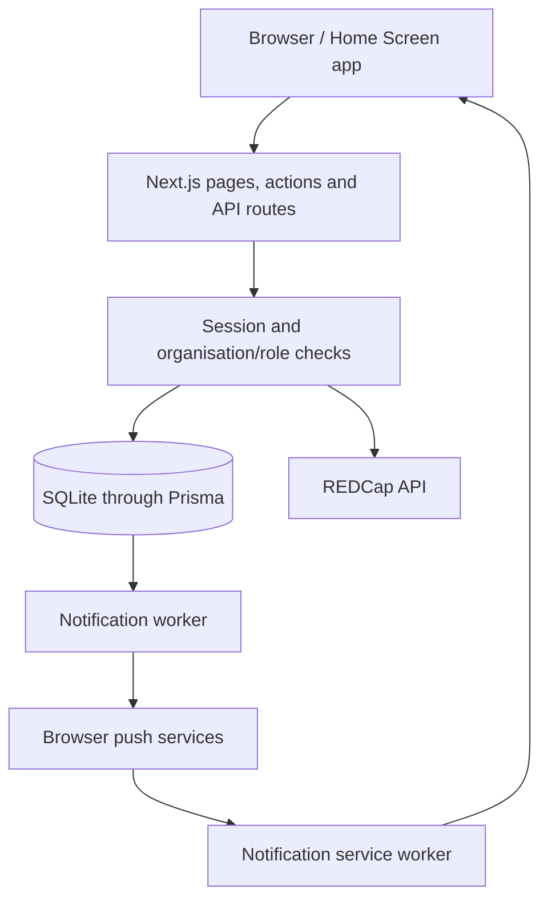

# PILS developer guide

This guide describes the `notification` branch as reviewed on 23 October 2026.
Start with [local setup](../README.md), then use this guide for implementation
and maintenance. HTTP endpoints are indexed in [API reference](API_REFERENCE.md).

For the reasons behind important behavior, see [Safeguards and operational
rules](SAFEGUARDS.md). It includes concrete date examples, exceptions, source
locations, regression tests and an arrival troubleshooting checklist.

## Branch integration status

`main` has been merged into `notification`. The integrated branch includes:

- Web Push, Home Screen icons, mobile navigation, signature credits, the logo
  Easter egg, and removal of Export Index.
- PILS-only Logs list/details and the admin organisation/status field layout
  fixes from `main` commit `0917b51`.
- The Mauritius-date notification safeguard from commit `9ae3859`.

Non-PILS users see Outreach Workflow, Notifications and Change Password, plus
account/sign-out controls. Notification settings remain available to every
role, but the Clinic Queue arrival category still requires PILS queue access.
When integrating later changes, keep the runtime guards, navigation, page
labels and regression-test expectations aligned. Switching branches does not
switch the database or installed services.

## Architecture



Next.js App Router provides server-rendered pages, server actions for account
operations, and HTTP route handlers for workflows. React client components
handle interactive forms. Tailwind CSS and shared CSS provide styling.

REDCap owns patient/programme records and repeating clinical instruments.
SQLite owns accounts, sessions, local queue state, and notification state.
SQLite also stores REDCap submission activity, including submitted data and
patient identifiers: treat the local database and its backups as sensitive.
There is no distributed transaction spanning REDCap and SQLite.

### Directory map

| Path | Responsibility |
| --- | --- |
| `app/` | Pages, shared root layout, account actions and API handlers |
| `components/` | Forms, queue board, navigation and shared UI |
| `lib/auth.ts`, `lib/organization-access.ts` | Runtime access checks |
| `lib/role-page-access.ts` | Human-readable role/page labels; not enforcement |
| `lib/instrument-forms*`, `lib/redcap-field-rules.json` | REDCap metadata snapshots and form helpers |
| `lib/redcap-validation.ts`, `lib/lookup-privacy.ts` | Validation and field-level privacy |
| `lib/clinic-queue.ts`, `lib/visit-workflow.ts` | Queue state and visit/service interpretation |
| `lib/clinic-appointments.ts`, `lib/new-appointment.ts` | Appointment extraction and scheduling |
| `lib/notification-*.mjs` | Push eligibility, payloads and delivery processing |
| `prisma/schema.prisma`, `prisma/migrations/` | Local data schema and ordered migrations |
| `locales/` | English, French and Mauritian Creole catalogs |
| `public/` | Static brand assets, push icons and service worker |
| `scripts/` | Setup, tests, workers and explicit data/schema utilities |
| `ops/` | Mac service, HTTPS, notification and migration runbooks |

## Local development

1. Clone and select the intended branch **before** installing dependencies.
2. Stop app/worker processes before bootstrapping an existing checkout.
3. Run `npm run setup:local`: installs the lockfile, preserves existing
   `.env.local`, generates Prisma, applies migrations and seeds an initial
   administrator only when needed.
4. Configure REDCap in `.env.local`, using a development REDCap project for
   development work. Start the app with `npm run dev`.
5. For push development, run `node scripts/setup-notifications.mjs`, then
   `npm run notifications:worker` in a separate terminal. Do not start a second
   continuous worker if the boot service is already active.

The installed Mac services pin Node **23.5.0**. The older README minimum of
20.9 describes the initial app; the notification API additionally calls
`URL.parse`, and the worker uses Node's `--env-file` option. Verify support in
any replacement runtime (`node -p "typeof URL.parse"` should print `function`),
and rerun checks before changing the service runtime. Use `package-lock.json`
for exact dependency versions rather than assuming the package ranges are exact.

### Environment variables

| Name | Use |
| --- | --- |
| `REDCAP_API_URL` | Server-side REDCap API endpoint |
| `REDCAP_API_TOKEN` | Server-side project token; never expose to the browser |
| `AUTH_COOKIE_SECURE` | `false` for local HTTP; `true` when serving exclusively through HTTPS |
| `VAPID_PUBLIC_KEY` | Permanent push application key; intentionally returned to signed-in clients |
| `VAPID_PRIVATE_KEY` | Server/worker signing key; keep private |
| `VAPID_SUBJECT` | Push application contact URI; currently the app's HTTPS URL |

The app reads `.env.local` through Next.js; the worker explicitly reads it via
`--env-file`. Restart each process after key/configuration changes. The key
setup script preserves existing keys. Back up the pair securely; rotating it
requires devices to unsubscribe/resubscribe. Commit placeholders only.

## Authentication and authorisation

Passwords use salted scrypt and timing-safe comparison. Sessions use random
browser tokens with SHA-256 hashes stored in SQLite, expire after seven days,
and require an `APPROVED` user. Cookies are HTTP-only and SameSite=Lax; Secure
is controlled by `AUTH_COOKIE_SECURE`. Password-change enforcement happens in
`requireUser()` unless explicitly bypassed for the password-change flow.

A user's roles are the union of legacy `role` and the JSON `roles` array.
`hasRole()` lets PILS administrators satisfy a requested role;
`hasAnyRole()` checks the explicit allowed list, so include `ADMIN` where
appropriate rather than assuming it is an automatic override there.

For non-PILS organisations, these helpers grant only Outreach capabilities,
even if a saved role says administrator. Logs list/details additionally require
PILS membership. Notification settings remain accessible, with each category
separately authorised. Audit actual guards as well as the role map.

| PILS role | Main capabilities (see source for complete page list) |
| --- | --- |
| Outreach Worker | Outreach; partial lookup |
| Healthcare Assistant | Outreach, clinic/PrEP, queue, appointments, lookup |
| Healthcare Navigator | Navigator workflow/queue; partial lookup |
| Facility Staff | Client enrollment, clinic queue, breakfast; partial lookup |
| Administrator | Administration and the combined operational pages |

Validate access in both pages and API handlers. Hiding a link is not access
control. Lookup also filters clinical and risk/violence data according to
permissions; never replace that filtering with UI-only hiding. External
patient-list responses exclude the clinical patient code.

## Local data model

| Model | Purpose |
| --- | --- |
| `User` | Identity, organisation, approval, roles and password policy state |
| `Session` | Hashed tokens and expiry |
| `AuditLog` | Account/security events |
| `RedcapActivity` | Actor attribution and local submission detail |
| `ClinicQueueEntry` | Daily visit identity, services, station, status and timestamps |
| `ClinicQueueEvent` | Transactional queue activity; arrival notification source |
| `NotificationPreference` | Account-level master/category opt-in and activation time |
| `PushSubscription` | Device endpoint/keys, locale and originating login session |
| `PushDelivery` | Per-visit/device delivery claim, attempts and retry schedule |

The SQLite path is configured in Prisma as `file:../data/pils.db` (relative to
the schema). A daily queue entry is unique on `(recordId, queueDate)` when a
record ID is present. The uniqueness migration archives duplicate rows and
moves their events before removing redundant queue entries.

Apply committed migrations with `npm run db:migrate`; generate the client with
`npm run db:generate`. Add a new migration for schema changes; do not edit an
already applied migration. Do not reset a populated database to fix migration
errors. A Prisma client retained by a running server may require restart after
generation. SQLite locks can require briefly stopping app and worker services.

## REDCap and clinical workflows

Workflow route handlers export the necessary REDCap fields, validate posted
values, import records/instrument instances, and record local actor activity.
Metadata snapshots drive field rendering, choices, branching and validation.
Do not infer field codes from labels: use the committed metadata and fixtures.

REDCap repeating rows must be joined to the enrollment identity by record ID;
follow-up rows alone may lack names. Preserve repeat instrument/instance
identifiers when reading or writing. Use the existing scheduling, patient-code
and no-show helpers to retain their conflict/retry protections.

For metadata changes, coordinate the REDCap project update with
`lib/instrument-forms.json`, `lib/redcap-field-rules.json`, choices and
`scripts/fixtures/redcap-schema.json`. Schema/migration utilities under
`scripts/` are not routine setup: read each before running it. Some explicitly
import records or alter REDCap metadata. `npm run check:redcap-schema` contacts
the configured project; fixture-based regression tests do not.

## Clinic queue rules

Queue dates use `YYYY-MM-DD` in **Indian/Mauritius**. Use `mauritiusToday()`
rather than the execution host's calendar date.

- Expected appointments are derived from REDCap and can appear as virtual rows.
  Local rows replace matching virtual records in the combined daily queue.
- Statuses are `EXPECTED`, `WAITING`, `READY`, `DONE`, `CANCELLED`. Stations are
  separate from statuses; see `QUEUE_STATIONS` for the complete list.
- Check-in persists the visit and assigns a daily queue number. The queue
  helpers handle repeated requests and same-client/date conflicts.
- `CLINIC`, `PREP`, and `BOTH` workflows hold independent purpose selections;
  service/task mapping lives in `lib/visit-workflow.ts`.
- Leaving file retrieval checks/saves the patient code before advancing.
  No-show marking/undo uses its own REDCap-aware helper and repeat-instance link.
- Changing stations is not a new arrival. `EXPECTED` → `WAITING` records
  `ARRIVED`; creating a row already waiting records `WALK_IN_CHECKED_IN`.

## Notification lifecycle

See the [notification runbook](../ops/notifications/README.md) for installation,
phone enrollment, retries and troubleshooting.

1. A signed-in user chooses account/category preferences and enables a device.
2. The browser registers `public/notifications-sw.js` and sends a push
   subscription to the authenticated API. No silent permission prompt is issued.
3. The standalone worker polls transactional queue events every three seconds.
4. Before delivery it checks approval, PILS membership, Clinic Queue roles,
   preferences, activation time and the originating unexpired login session.
5. Only arrivals whose queue date equals both the arrival-event date and
   today's Mauritius date qualify. Past/future exercises do not notify, including
   across-midnight retries. **Exercises dated today still notify.**
6. Each daily queue entry/device has one delivery record. The transport uses
   stable topics/tags, retries transient failures, removes 404/410 endpoints,
   and expires arrival alerts after ten minutes. Crash recovery is at least
   once; exact-once device presentation is not guaranteed.

Payloads contain the name and code, or “Code pending”; they can appear on lock
screens. Tapping opens the authenticated queue. Logout/expiry stops future
sends for that subscription; re-enable after signing in again. The service
worker handles notifications only and does not cache patient pages/API data.
The explicit test button sends a sample notification directly and does not
use the arrival-date rule or account/category arrival switches.

## UI, localisation and branding

Shared navigation is generated on the server, then wrapped in
`HeaderNavigation` for mobile interaction. Below 768px it is a burger menu;
desktop retains a visible navigation bar. Keep its visibility CSS in one place
in `app/globals.css` to avoid competing utility rules.

`LocalizationProvider` supplies `t()` and also translates rendered text and
selected attributes. Update all three `.strings` catalogs together (`en`,
`fr`, `mfe`) and run the coverage test. Some dynamically assembled text requires
manual review beyond the static extractor. Push text uses the stored device locale.

`public/pils-logo.svg` is the full logo; `public/pils-home-icon.svg` contains the
centered ribbon P. The manifest points to 192/512 PNGs; `app/apple-icon.png`
serves the Apple icon. Re-render those assets together after changing the source.
Phones may retain old icons until the Home Screen app is re-added.

The root layout includes a selectable, normally transparent signature.
`LogoCelebration` triggers five seconds of emoji confetti after five presses
within two seconds, on both header and auth-page logos. The overlay ignores
pointer input and has a reduced-motion alternative. Source-header dates came
from local filesystem birth metadata, not verified original authorship dates.

## Validation and contribution workflow

For a change, select the relevant feature tests from `package.json` and run:

```sh
npx next typegen
npx tsc --noEmit
npm run lint
npm run test:localization
npm run test:organization-access
```

| Changed area | Additional checks |
| --- | --- |
| Queue/check-in | `test:clinic-queue`, `test:queue-deduplication` |
| Codes/no-shows | `test:queue-patient-code`, `test:queue-no-show` |
| Scheduling | `test:clinic-appointments`, `test:new-appointment`, `test:clinic-lab-review-formula` |
| REDCap forms | `test:redcap-fields`, plus the applicable workflow test |
| Enrollment/lookup | `test:client-enrollment`, `test:lookup` |
| Navigator queue | `test:hcs-upcoming` |
| Push | `test:notifications`, then real-device testing with the sample button |

Use the names above as `npm run <name>`. The notification test uses temporary
SQLite and a mock transport, not real push recipients. Other tests include
source-transpilation/mocked-route assertions; passing them does not replace
browser checks of layout or phone checks of permission/delivery behavior.

`npm run build` validates the production bundle; the current `next/font/google`
setup needs network access to fetch fonts. A fetch failure is not evidence of
an application type error. `npm run start` requires a completed build.
Read the relevant guides under `node_modules/next/dist/docs/` before changing
Next.js APIs, and follow [AGENTS.md](../AGENTS.md).

Commit code, lockfile updates, metadata/fixtures, migrations and documentation
as applicable. Do not commit `.env.local`, database/WAL/SHM files, private keys,
patient exports, `.redcap-backups/`, `.next/`, `next-env.d.ts` changes or build
cache changes. Some generated files are historically tracked; stage changes
selectively. Do not run every script merely because it is under `scripts/`.

## Hosting, upgrades and recovery

The current documented host is a Mac Mini with separate launchd services for
the app, Caddy and the notification sender. The app service still runs
**`next dev`**, not a production build. HTTPS does not imply production mode.
See [app service](../ops/launchd/README.md), [HTTPS](../ops/caddy/README.md),
and [notifications](../ops/notifications/README.md).

The request path is public HTTPS → router TCP 443 → Caddy → localhost:3000.
TCP 80 goes to Caddy for validation/redirects. No-IP supplies the dynamic
hostname; keep its updater and free-hostname confirmation current. The worker
needs outbound HTTPS to push providers. Do not forward its or Caddy's admin ports.

Before upgrades or branch switches on this host, stop affected services,
back up SQLite consistently (SQLite backup API or all writers stopped), preserve
secrets/VAPID keys, and install the target branch's dependencies. Apply its
migrations, regenerate Prisma and restart services. Regenerate Next route types
if stale validators reference deleted routes. Verify HTTPS, login, intended
page access, queue behavior and a sample push after restart.

A Git checkout does **not** roll back SQLite migrations, REDCap changes or
installed launchd plists. Restore code/database versions together when a
schema rollback is necessary; do not copy only a live SQLite main file while
ignoring its WAL. Keep backups outside tracked source and restrict access.
